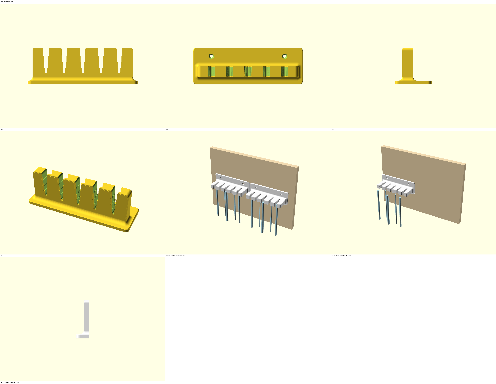

# Silicone tube drying holder (wall comb) — technical specification datasheet

*Full technical record for the 3D printing advisor and the approvers. The short, visual README.md is what users read; this file holds the details. Internal document — no licence statements or certification marks.*

## General Information
| Field | Value |
|---|---|
| Internal Ref. | N/A |
| Name | Silicone tube drying holder (wall comb), `tube_holder` |
| Product stage | Product in development — draft for review |

## FORM
### Product picture

### Version / Category / Subcategory / Critical item / Dangerous goods / Short description
- Version: 2.0
- Category: Medical
- Subcategory: IPC / sterilisation (CSSD)
- Critical item: Yes — new part in the hospital environment, holds cleaned items before sterilisation (design rules §4.2)
- Dangerous goods: No
- Short description: A wall-mounted comb with five open-front stair slots. Each slot opens toward the room in four pockets, one per tube size (10 / 8 / 6 / 4 mm outside diameter): a pocket is 6 % narrower than its tube at the top face of the 18 mm shelf and 13 % at the bottom face, and the step behind it is a hard stop. A washed silicone tube is pushed in sideways until it stops at its step and hangs straight down to drain and dry; the grip is set by the pocket, not by the push. Two combs side by side hold 10 tubes.
### Dimensions / Use / Solution type
- Overall dimensions (print position, X × Y × Z): comb 180 × 60 × 60 mm at default parameters (shelf 164 wide, 54 deep, 18 thick; plate 6 mm); test slot 60 × 36 × 60 mm. Parametric: 1–8 slots, pitch 20–50 mm, four pocket sizes, 200 mm maximum per axis enforced by a guard.
- Single/Multiple use: multiple use, permanent installation
- Permanent/Temporary solution: permanent, replaced by reprinting at the first crack
### Intended use and out-of-scope uses
- Intended situations of use: sterilisation room, drying stage between washing and packing; washed silicone tubes of 4, 6, 8 and 10 mm outside diameter (one pocket each; sizes are parameters), hung from their upper end.
- Explicitly not intended for: patient contact / patient support / drug delivery / diagnosis / therapy / contact with unpackaged food, drink or medicine / loads above 2 kg per comb / tubes outside the four pocket sizes / thin-walled soft tubes that slide out of their pocket on the test slot / hanging anything but tubes / sterile storage.
### Readiness (Humanitarian Making scale — https://humanitarianmaking.org/resource/readiness-levels) — every level proposed until the 3D printing advisor confirms it
- Field readiness: **2 (proposed)** — "Item meets some criteria but significant change needed" — essential and replicable; quality and safety not yet checked on a printed part (no first article, no load test).
- Maker readiness: **4 (proposed)** — "Some training may be needed to successfully make the items. Tools may be required but may be basic or readily available. Knowledge on replication is passed on simply" — single printed part plus two wood screws with plugs; a drill and a screwdriver are needed (MSF rule: printed part with locally available hardware → 4 or 3).
- User readiness: **3 (proposed)** — "Item meets most criteria but still room for marked improvement" — commonly needed, intuitive to use; not in an existing catalogue, no established standard for a drying comb.
- Technology readiness: **2 (proposed)** — "Active research and development is initiated. This includes analytical studies and laboratory studies to physically validate analytical predictions of separate elements of the technology" — design verified by automated checks only; 3 after the test slot and first article at the site, 4 after the follow-up checks.
- Risk level: **3 (proposed)** — "Elevated: Item and/or process has a few risk concerns" — critical item (MSF rule: 3, 2 or 1): dropped tubes must be re-cleaned; the comb is a contact surface for cleaned items and must be on the cleaning schedule.
### Justification of using 3D printed item
- Commercial tube racks use pegs or hooks, which fold the tube and trap water in the bend; a comb that lets tubes hang straight for their whole length, with a pocket per tube size, is not a catalogue item. A printed comb is made on site in an afternoon, adapted to the tube sizes and the wall space with the Customizer, and replaced by reprinting.
### Approval required by
- Biomed advisor and IPC advisor (critical item); the 3D printing advisor validates the readiness levels and the follow-up checks.

## FIT
### Compatibility
#### Primary compatibility
- Silicone tubes, outside diameter 4, 6, 8 and 10 mm (4 and 8 measured by the requester, 6 and 10 chosen by him). Pocket widths at the top face 9.4 / 7.5 / 5.6 / 3.8 mm, at the bottom face 8.7 / 7.0 / 5.2 / 3.5 mm; pocket lengths 13 / 11 / 9 / 7 mm; the steps between pockets are about 1 mm deep. Contact height 15 mm (18 mm shelf minus the edge roundings). Tubes hang 15–50 mm clear of the wall depending on their pocket.
- Rigid tube-end connectors: not used by the hold. A connector wider than the mouth (9.4 mm) would rest on the top face of the shelf; not required.
#### Compatible accessories
- 2 (or 3) wood screws Ø 4 mm (parameter `screw_d` 3–6 mm), countersunk or pan head up to Ø 8 mm (`screw_head_d`), with Ø 6 mm wall plugs; hole = screw_d + 0.5 mm + 0.2 mm printing compensation (loose: the plug does the aligning).
### Tolerance to misalignment
| Case | Variation | Result |
|---|---|---|
| Tube diameter | −0.5 / +0.3 mm around each pocket size | the pocket still grips (6 → 13 % squeeze band); a tube 1 mm too big stops at the previous step, 1 mm too small slides on to the next pocket |
| Tube wall thickness | 1.5–2.5 mm | the grip scales with the wall stiffness; a 1 mm wall at 10 mm is too soft — test slot |
| Tube pushed in more or less deep | until the step | the step is a hard stop; pushed less deep it sits in a wider pocket and slides out — always push to the stop |
| Wall not flat / plate rocking | up to ~1 mm | 6 mm plate, 2 screws 120 mm apart; shim if the wall is uneven |
### Parameters (Customizer)
| Parameter | Default | Range | What it changes | Confirmed by test print |
|---|---|---|---|---|
| part | holder | holder, test_slot | comb with plate, or the one-slot test piece | — |
| slot_n | 5 | 1–8 | slots per comb (guard: part ≤ 200 mm) | not confirmed |
| slot_pitch | 30 | 20–50 mm | distance between tube centres | not confirmed |
| pocket_1 … pocket_4 | 10 / 8 / 6 / 4 | 2–16 mm | tube outside diameter of each pocket, mouth to wall | not confirmed |
| squeeze_top / squeeze_bottom | 6 / 13 | 2–12 / 4–20 % | pocket narrower than its tube at the top / bottom face | not confirmed |
| pocket_extra | 3 | 2–6 mm | pocket length = tube diameter + this | — |
| shelf_t | 18 | 12–26 mm | shelf thickness = height of the gripping walls | not confirmed |
| bar_w | 12 | 8–25 mm | solid shelf between the slot end and the plate (tube distance from the wall) | — |
| side_w | 22 | 12–40 mm | outer tube centre to the shelf side edge | — |
| edge_r | 1.5 | 0.8–3 mm | rounding of every shelf edge on the top and bottom face | — |
| step_r | 0.4 | 0.2–1 mm | rounding of the pocket corners and step tips | — |
| tip_r / corner_r | 4 / 4.5 | 2–8 / 3–10 mm | finger tip and outer corner rounding in plan | — |
| root_r | 6 | 2–12 mm | cove all round the shelf root | — |
| plate_t | 6 | 4–10 mm | wall plate thickness | — |
| plate_above / plate_below | 30 / 12 | 16–60 / 8–40 mm | plate height above and below the shelf | — |
| plate_corner_r | 6 | 3–12 mm | plate corner radius | — |
| screw_n / screw_d / screw_head_d | 2 / 4 / 8 | 2–3 / 3–6 / 5–12 mm | wall screws and countersink | — |
| screw_clr / screw_edge / screw_spacing | 0.5 / 14 / 120 | 0–1.5 / 8–30 / 30–180 mm | hole clearance, screw height, screw distance (reduced automatically on a narrow plate) | — |
### Manufacturing Instructions
#### 3D printing optimization
- Modelled and exported in print position: wall plate flat on the bed, shelf standing, slots pointing up. Bottom edges chamfered 0.4 mm, plate top edges chamfered 0.8 mm, plate corners R 6; every pocket wall, step and edge rounding is a vertical surface in the print (the pockets narrow in the thickness direction, never toward the bed), the steps face up, cove R 6 all round the root — no overhang above 45°, no bridge; screw holes vertical with +0.2 mm compensation and 90° countersinks facing up. Print as provided: no supports, no brim, do not re-orient.
#### Material and color
- PETG white / natural / light colour — preferred (on the shelf; wiping with Surfanios, bleach 1:10, IPA). PLA light colour — acceptable indoors at room temperature, wiping only (more brittle; keep away from heat sources). ASA light colour — acceptable if that is what is on the shelf, advisor to confirm. Light colour is an IPC rule: soiling and surface defects must stay visible. One material per comb.
#### List of other materials
- 2 × wood screw Ø 4 mm (length by wall type, typically 40 mm) with Ø 6 mm plugs per comb.
#### 3D Printer
- Any FDM printer with a bed ≥ 185 × 65 mm; reference: Original Prusa MK4S, 0.4 mm nozzle.
#### Slicer settings
- Works with the printer's default profile (2 perimeters, 15 % infill); recommended for a longer life: 0.2 mm layer height, 4 perimeters, 40 % infill; no supports; no brim; print sheet for the material, no glue. Reference on the MK4S at default settings: about 6.5 h and 95 g per comb, about 1.5 h and 25 g for the test slot (confirm in PrusaSlicer 2.9). Every STL is in its print position — do not rotate.
#### Post processing instructions
- Remove stringing; run the deburring tool along the slot mouths if a seam is felt; wash with soap and water; wipe with the site disinfectant before installation.
#### Assembly instructions
1. Print and try the test slot with the real tubes (every size in use): each must stop at its own step, stay when let go — also wet, also with a two-finger pull straight down — and come out with a forward pull.
2. Choose a wall above a sink, a drip tray or a washable floor, away from workstations and walkways; comb height ≥ longest tube + 200 mm above the floor.
3. Mark the holes (120 mm apart, from the plate), drill Ø 6 mm, fit plugs, screw on with 2 × Ø 4 mm screws; second comb beside it with about a 5 mm gap. No rocking.
4. Clean before use; hand over with the README check table.
#### QC procedures
- Visual inspection: complete slots, no gaps between layers, no stringing in the slots, no cracks at the shelf root, countersinks clean.
- Dimensional validation (calipers): first pocket 9.4 ± 0.2 mm at the top face and 8.7 ± 0.2 mm at the bottom face; last pocket 3.8 ± 0.2 / 3.5 ± 0.2 mm; shelf thickness 18.0 ± 0.2 mm; plate 180 ± 0.5 mm; screw holes 120 ± 0.5 mm apart, Ø 4.7 ± 0.2 mm.
- Tolerance inspection: each tube size stops at its own step (10 mm at the first, 4 mm at the end), stays when let go and does not slide down under a two-finger pull; the pocket 0.5 mm too small for a tube must not be reachable with a normal push.
- Safety validation: Biomed and IPC advisor before use.
- Test before use: function (each tube size, 10 cycles in/out; pull each tube straight down with two fingers — it must stay) · fit (each size stops at its own step) · cleaning (wipe, no residue in the slot ends) · edges (nothing sharp on glove or tube) · load (4 kg hung on the front edge of the shelf for 1 min, 3 times: no crack, no whitening, no rocking) · drop test not applicable (fixed to the wall) · test to failure: not required — low load, failure drops tubes only; skip.
- Follow-up after installation, each visit validated by the 3D printing advisor:
| When | What to check | Result | Checked by | Validated by (3D printing advisor) |
|---|---|---|---|---|
| Installation day | screws tight, no rocking, tubes hold and hang straight, cleaned | | | |
| + 2 weeks | cracks, whitened areas at the shelf root and slot ends, loosening, cleanliness, still in intended use | | | |
| + 1 month | same + wear or permanent deformation in the slots, screws tight | | | |
| + 3 months | same + decision: keep / reprint / redesign | | | |
| + 6 months, + 12 months, then every 6 months (critical item) | same | | | |

## FUNCTION
### Detailed description
The shelf is a comb of six fingers around five slots. Seen from above, each slot is a stair: it opens toward the room in four pockets, from 3.8 mm wide at the wall end to 9.4 mm at the mouth, each pocket sized for one tube (4 / 6 / 8 / 10 mm) and about 1 mm narrower than the next. A tube pushed in from the front slides through the wider pockets and stops at the step of its own pocket, which it cannot pass without being squeezed by a fifth of its diameter. In its pocket it is held by friction between two flat walls 15 mm high that squeeze it by 6 % at the top face; the walls close slightly toward the bottom face (13 %), so a tube that starts to slip settles tighter and stops at the pocket bottom — the squeeze can never exceed that. Nothing depends on how hard the tube was pushed in. Every edge the tube touches is rounded (R 1.5), the pocket corners and step tips R 0.4, the slot end round. The shelf meets the wall plate in a R 6 cove all round; the plate carries two countersunk Ø 4 mm screws above the shelf. Tubes hang 15–50 mm off the wall; the shelf is open so nothing holds water.
### Additional notes
- Unverified values: the tube wall thickness (sets the grip) and the exact sizes of the 6 and 10 mm tubes — confirmed on the test slot.
- Directions: the slot narrows toward the wall in steps; push in from the front to the stop, pull forward to release. A tube is held by friction in its pocket; the step stops it going deeper, the pocket bottom stops it settling further.
- Hand estimates (default part, PETG): shelf root bending at the design load of 2 kg on the front edge ≈ 0.2 MPa (test load 4 kg ≈ 0.4 MPa; root section 164 × 18 mm), against a cross-layer strength of about 20 MPa; one finger with a 50 N yank at its tip ≈ 1.5 MPa at its root. Grip (ring-compression estimate, silicone E ≈ 3 MPa, μ ≈ 0.5 wet): 10 mm tube with 2 mm wall — about 1 N per wall at the top squeeze, up to 2 N at the pocket bottom, i.e. 2–4 × the weight of 1 m of tube; 8 mm / 1.5 mm wall — 2 N per wall, 5 × its weight; 4 mm / 1 mm wall — 1 N per wall, 9 × its weight; 10 mm tube with a 1 mm wall — 0.3 N, below its weight: not held.
- Deviations from the design rules: the pocket corners and step tips are rounded R 0.4, below the 1 mm rule, because a step is only about 1 mm deep — they are vertical corners inside a pocket a wipe reaches from both faces. The `test_slot` part is the coupon (the pockets are the steps). Slot ends and finger tips are rounded, not chamfered, because every rounded face points up or sideways in the print orientation.
- Known limits: the hold is friction with a bounded squeeze, so it is only as strong as the tube's wall: thin-walled (≈ 1 mm) tubes of 8–10 mm slide out; a hard downward tug (about 300 g on a 10 mm tube) pulls a tube out without damage. Tubes heavier than about 300 g each were not considered. If the site's tubes differ from the four sizes, set the four pocket parameters and reprint.
### Cleaning and disinfection / sterilization procedures
- Agents: Surfanios, bleach 1:10 or IPA; follow the IPC guidelines of the site; wipe every slot, the top and the underside of the shelf and the cove. Do not use an autoclave.
### Packaging and storing instructions
- Spare combs in sealable zip-lock bags; room temperature; no direct sunlight or humidity.
### Related links, standards, safety considerations
- No text or embossed symbols on the part (it is cleaned); identification in this documentation only.
- Warnings: not a patient-support device; do not autoclave; hang only silicone tubes; replace a cracked or whitened comb; water drips from the tubes — mount over a sink, a drip tray or a washable floor; not above a workstation or a walkway.
- Repository: to be published on the MSF Printables profile after approval.
### Spaulding Classification (IPC)
- No patient contact — non-critical surface that touches reprocessed (cleaned, not yet sterilised) items; to be confirmed by the IPC advisor.
### Risk assessment (critical item)
| # | Hazard / failure point | Foreseeable harm | Likelihood | Severity | Mitigation (designed-in / procedural) |
|---|---|---|---|---|---|
| R1 | Tube slides down out of its pocket (thin wall, slippery, wrong pocket) | tube on the floor, re-cleaning, delay | low | low | pocket per size with a hard stop, 15 mm contact, pocket narrows downward; test slot with the real tubes before printing; two-finger pull test before use; check the pockets at follow-up; reprint at wear |
| R2 | Comb breaks at the shelf root or a finger (overload, crack) | tubes on the floor | very low | low | root cove, 18 mm shelf, load test 4 kg before use; 2 kg limit in the README; replace at the first crack |
| R3 | Comb detaches from the wall | tubes on the floor, comb falls (< 100 g) | very low | low | 2 plugs and screws, 120 mm apart; not above workstations; screws checked at follow-up |
| R4 | Comb surface contaminates cleaned tubes | reprocessing failure | low | medium | light colour (soiling visible), rounded open geometry, no recesses; on the cleaning schedule; IPC sign-off |
| R5 | Water from tubes on the floor | slip | medium | low | mount over a sink or drip tray; procedural |
| R6 | Dark or wrong filament used | soiling invisible, weak part | low | medium | README material list; light colour only |

## VERIFICATION (from the build)
| Test | Result | Evidence |
|---|---|---|
| Render at defaults + sweep (T1–T3) | PASS — 39 PASS, 16 GUARD, 0 FAIL of 55 cases (every parameter at its min and max); the guard stops are range ends where the model refuses with a plain-language message (part over 200 mm, pocket sizes not decreasing toward the wall, squeeze_bottom below squeeze_top, outer finger too thin, step rounding bigger than the step, cove into the slot ends, plate too thin, screws too close to the shelf). One case (edge_r = 3) exposed a 0.55 mm sliver where the cove ring stood off the sliced edge rounding — fixed by extending the cove profile 1 mm into the shelf, re-run PASS | tools/sweep_report_2026-09-27.txt |
| Watertight, bodies, size, print position (T4–T6) | PASS — 1 body, 180 × 60 × 59.9 mm, min Z 0.0, bed contact 98 % of the footprint (test slot 97 %) | stl/EXPORT_LOG.txt, stl/*.check.json |
| Overhangs / bridges (T7–T8, two passes) | worst 45.0° (the 0.4 mm bottom chamfer); 0 facets over the limit at min-area 0.5 and 0.02; horizontal downward faces: none (the steps face up) | check_stl output in the export log |
| Sections and walls (T19) | Z 3 / 10 / 30 / 50 mm: one piece in the plate, 6 pieces = 6 fingers in the shelf; smallest measured wall 12.9 mm | export log |
| One-file Customizer version identical (T22) | PASS — same volume 200 044 mm³ (± 0.5), same size; no non-literal parameter | flatten_scad.py --verify |
| Copies (T23) | PASS — holder_1 and holder_2 byte-identical | cmp |
| Render set (T14) | front, top, side, isometric, installed (two combs, tubes), exploded, section through the shelf (the stairs from above), sheet; test slot views | img/ |
| Native OpenSCAD 2021.01 | previews without warnings or errors (CGAL fallback for field laptops) | render log |
| Not verified | physical print, grip on the site's tubes (wall thickness unknown), 4 kg load test, disinfectant wipe test | — |

## ATTACHMENTS
- Files in the package: tube_holder.scad, tube_holder_customizer.scad, tube_holder_context.scad, common.scad, helpers.scad, STLs (holder_1, holder_2, test_slot — all in print position), renders, tools with the sweep report, brief and plan, STATUS.md — none containing personal data.
- Made with the msf-3dp-design skill v1.3; exporter OpenSCAD 2025.07.18 (Manifold, openscad-wasm 0.0.4) — recorded in stl/EXPORT_LOG.txt; files written at the OpenSCAD 2021.01 language level.

| Role | Name | Date |
|---|---|---|
| Designed by | MSF 3D Printing for All | 2026-09-26 |
| Product approved by | | |
| Product tested by | | |

## VERSION HISTORY
| Version | Date modified | Modified by | Changes |
|---|---|---|---|
| 1.0 | 2026-09-26 | MSF 3D Printing for All | Initial design: tapered plan slot, tube held by a friction wedge |
| 1.1 | 2026-09-26 | MSF 3D Printing for All | V-slot (16 → 2 mm through the shelf thickness): tube held by geometry; rejected by the requester — the V squeezed the big tubes under their own weight |
| 2.0 | 2026-09-27 | MSF 3D Printing for All | Stair slots as requested: four pockets per slot (10 / 8 / 6 / 4 mm), 6 → 13 % squeeze, hard stop behind each pocket, shelf 18 mm; new construction (drafted core + inset slices for the edge rounding) |
