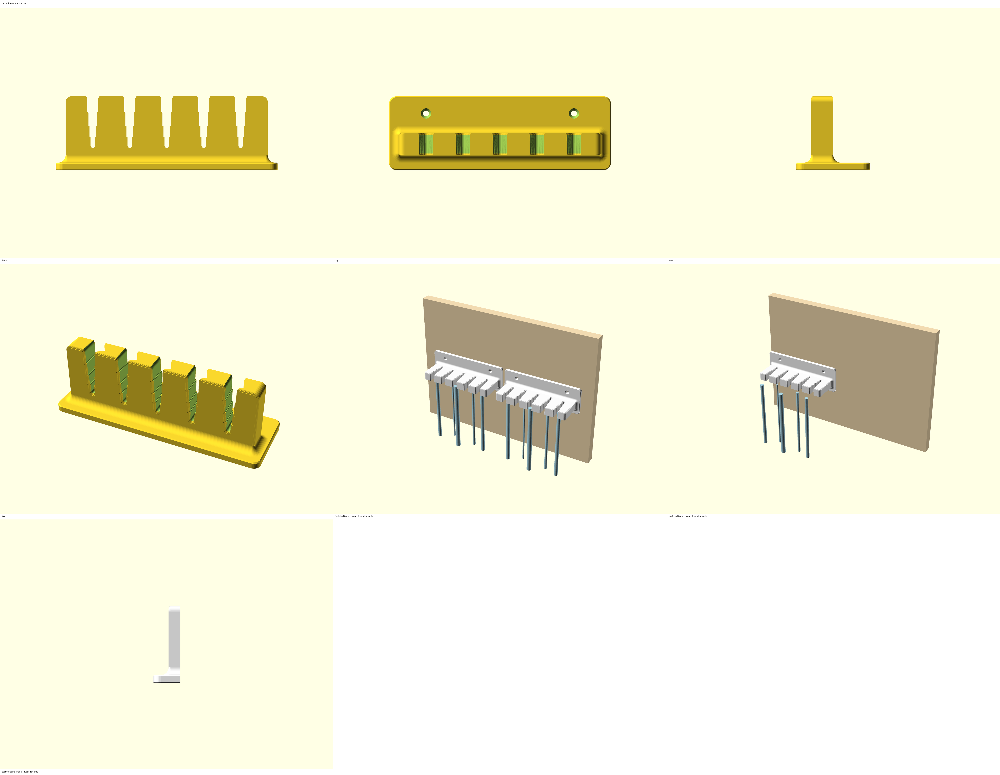
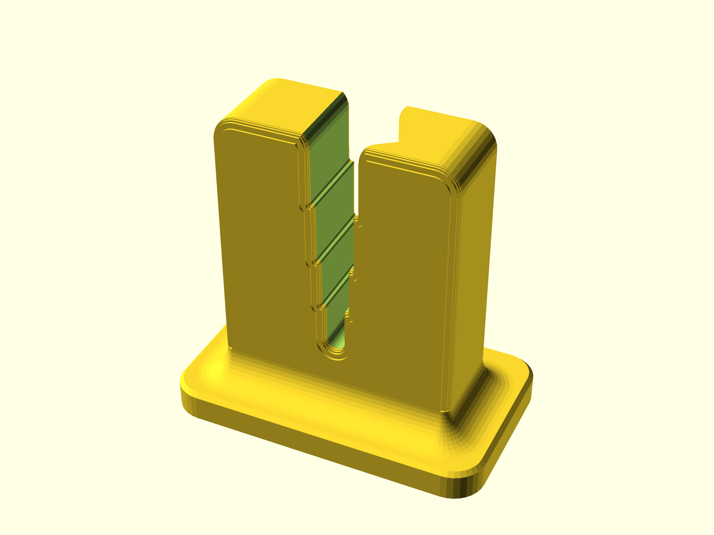
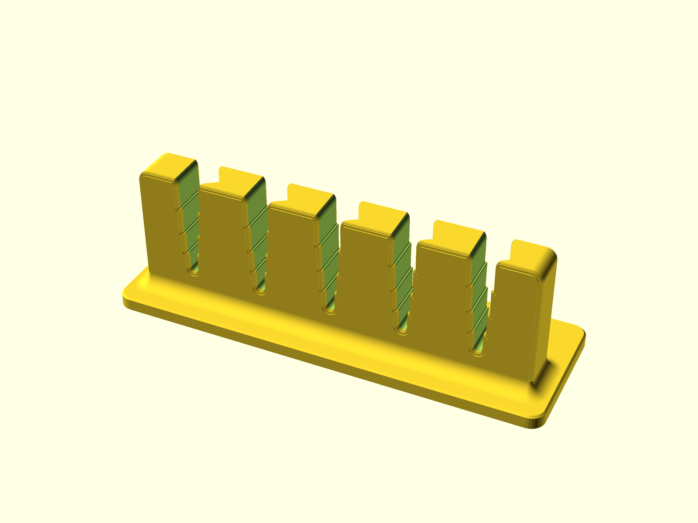
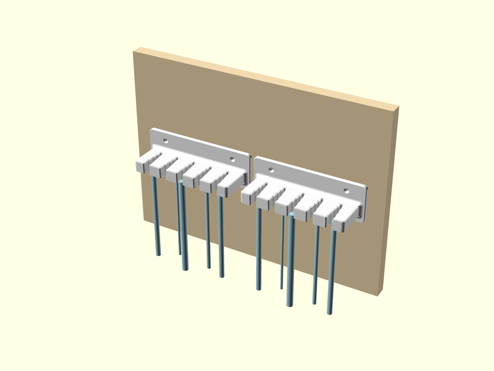
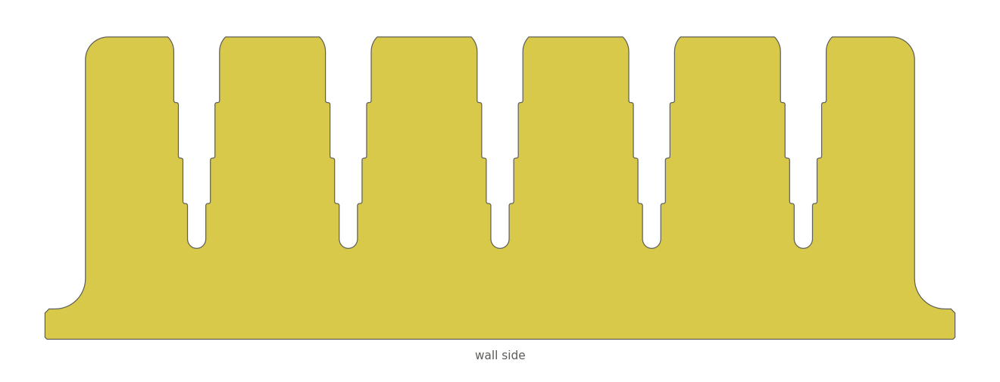

# Silicone tube drying holder (wall comb)

**What it is:** a wall comb with five stair slots. Each slot opens toward the room in four pockets, one per tube size (10 / 8 / 6 / 4 mm): a washed silicone tube is pushed sideways into the slot until it stops at its own step, and hangs straight down to drain and dry — never folded over a hook. The pocket is a little narrower than the tube (6 % at the top of the shelf, 13 % at the bottom), so the grip is set by the pocket, not by how hard the tube is pushed in. **Use:** sterilisation room, drying stage after washing; two combs side by side = 10 tubes. **Not for:** patient support, hanging anything but tubes, loads above 2 kg per comb, tubes outside the four pocket sizes.
**Fits:** silicone tubes of 4, 6, 8 and 10 mm outside diameter (each has its own pocket; the sizes are parameters). Tubes with a thin wall (about 1 mm at 10 mm diameter) are too soft for this hold — try them on the test slot. Wall screws Ø 4 mm with plugs (Ø 3–6 mm as a parameter). **Critical item:** yes — Biomed and IPC advisor approval before use.

## Parts to print
| # | Part | File | Qty | Picture |
|---|---|---|---|---|
| C | **Test slot — print first** and try your tubes on it (every size you have) | `stl/tube_holder_test_slot_v2.0.stl` | 1 |  |
| 1 | Comb, 5 slots | `stl/tube_holder_holder_1_v2.0.stl` and `stl/tube_holder_holder_2_v2.0.stl` | 2 |  |

All files are in print position: import, slice, print. No supports, no brim, nothing to rotate.

## Print
- Material: PETG in white, natural or a light colour (preferred); PLA in a light colour is acceptable (indoor, room temperature, wiping only); ASA light colour if that is what is on the shelf — ask the 3D printing advisor. Never a dark colour: soiling must stay visible.
- Settings: works with the printer's default profile (2 perimeters, 15 % infill); recommended 0.2 mm layers, 4 perimeters, 40 % infill · about 6.5 h and 95 g per comb on the MK4S at default settings, about 1.5 h for the test slot (check the slicer estimate).
- Print sheet for the material, no glue. After printing: deburr the slot edges with the deburring tool if the slicer left a seam, wash with soap and water.

## Install / use

1. Try the test slot first: push each tube size into the slot from the front until it stops — it must stay when you let go and come out with a forward pull. A tube that slides down or needs force to reach its step goes on the report.
2. Choose the place: a wall above a sink, a drip tray or a washable floor — water drips off the tube ends. Mount at a height where the longest tube hangs free (comb height above the floor ≥ tube length + 200 mm). Not above a workstation or a walkway.
3. Mark the two screw holes (120 mm apart), drill, fit Ø 6 mm plugs, screw the comb on with 2 × Ø 4 mm screws. Second comb next to it, about 5 mm gap. The comb must not rock.
4. Use: hold the tube 3–5 cm below its upper end, push it sideways into the slot from the front until it stops at its step (a 10 mm tube stops first, a 4 mm tube goes to the end) and let go. One tube per slot, hanging straight. To remove: pull forward.

## Clean
Wipe with Surfanios, bleach 1:10 or IPA — every slot, the top and the underside of the shelf. Do not autoclave. Add the comb to the room's cleaning schedule: it touches cleaned tubes.

## Check
**Before use:** each tube size stops at its own step, stays when let go and pulls out forward (10 cycles) · a wet tube pulled straight down with two fingers stays in its pocket · no sharp edges on glove or tube · wiped clean, no residue in the slots · 4 kg hung on the front edge for 1 minute, three times: no crack, no white marks, no rocking. **Then, validated by the 3D printing advisor:**
| When | Check | Date | Result | Validated |
|---|---|---|---|---|
| Installation day | screws tight, no rocking, tubes hold, cleaned | | | |
| + 2 weeks | cracks, whitened areas, loosening, cleanliness, tubes still hang straight | | | |
| + 1 month | same + wear in the slots, screws tight | | | |
| + 3 months | same + keep / reprint / redesign | | | |
| + 6 months, + 12 months, then every 6 months (critical item) | same | | | |
Replace at the first crack or whitened area — reprinting is the normal fix.

## Details
`DATASHEET.md` — full specification, parameters, tests, risk assessment, readiness, version history. `tube_holder_customizer.scad` — one-file version for the OpenSCAD Customizer (slot count, pitch, the four pocket sizes, the squeeze, shelf thickness, screw size are parameters).

| Role | Name | Date |
|---|---|---|
| Designed by | MSF 3D Printing for All | 2026-09-27 |
| Approved by (Biomed / IPC) | | |
| Tested by | | |

Version 2.0 — 2026-09-27 — msf-3dp-design skill v1.3 (1.0 tapered friction slot and 1.1 V-slot rejected by the requester: tubes fell when not squeezed in / the V squeezed the big tubes; 2.0 stair slots with one pocket per size, requested by him)
